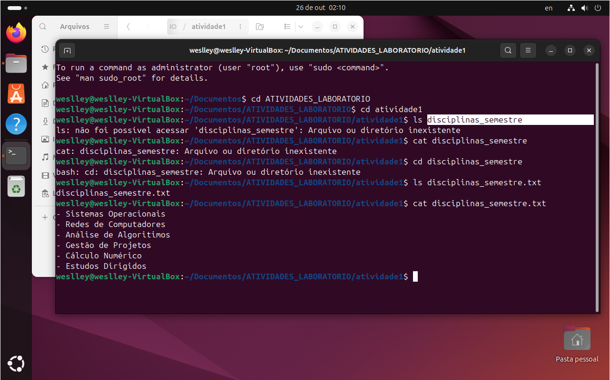

<div align="center">

# 🐧 Linux System Administration & Shell Lab
### Ambiente GNU/Linux Ubuntu, Virtualização e Administração via Terminal Bash


</div>

---

## 📌 Visão Geral do Projeto

Este projeto documenta o provisionamento, configuração e operação de um ambiente virtualizado **GNU/Linux Ubuntu** utilizando o hipervisor **Oracle VM VirtualBox**. O laboratório foca na administração do sistema operacional através da interface de linha de comando (CLI), abordando gestão de diretórios, manipulação de arquivos de texto, permissões e comandos essenciais de diagnóstico.

A prática simula procedimentos comuns em rotinas de suporte técnico N1/Helpdesk, operação de servidores Linux e resolução de incidentes de infraestrutura.

---

## ⚙️ Provisionamento da Máquina Virtual

A infraestrutura virtualizada foi configurada com os seguintes parâmetros técnicos:

* **Sistema Operacional Convidado:** GNU/Linux Ubuntu (64-bit)
* **Memória RAM alocada:** 2048 MB (2 GB)
* **Armazenamento:** Disco rígido virtual VDI com alocação dinâmica (10.00 GB)
* **Interface de Rede:** Adaptador em modo NAT para saída externa à internet

---

## 💻 Operações e Comandos Executados

### 1. Gestão de Usuários e Sessão
* `who`: Exibe os usuários ativos na sessão atual.
* `passwd`: Permite a troca e atualização segura de credenciais de acesso.
* `clear`: Limpa o buffer de exibição do emulador de terminal.

### 2. Navegação e Manipulação da Árvore de Diretórios
* `pwd`: Retorna o diretório de trabalho atual (caminho absoluto).
* `mkdir -p ATIVIDADES_LABORATORIO/atividade1`: Criação estruturada da hierarquia de pastas.
* `cd`: Navegação entre níveis da árvore de diretórios (`cd /`, `cd ~`, `cd ..`).
* `ls -la`: Listagem detalhada de arquivos e diretórios, incluindo permissões e arquivos ocultos.

### 3. Manipulação de Arquivos e Redirecionamentos
* `cat > disciplinas_semestre`: Redirecionamento de fluxo de entrada padrão para escrita direta no arquivo.
* `cat disciplinas_semestre`: Concatenação e leitura imediata do conteúdo do arquivo no terminal.

```bash
# Fluxo de comandos executado no terminal
$mkdir ATIVIDADES_LABORATORIO$ cd ATIVIDADES_LABORATORIO
$mkdir atividade1 && cd atividade1$ pwd
/home/usuario/ATIVIDADES_LABORATORIO/atividade1

$ cat > disciplinas_semestre << EOF
Sistemas Operacionais
Redes de Computadores
Análise de Algoritmos
Gestão de Projetos
Cálculo Numérico
Estudos Dirigidos
EOF

$ cat disciplinas_semestre
```

---

## 📸 Validação e Execução Prática

Abaixo está o registro da execução dos comandos e a validação da estrutura criada no terminal do Ubuntu:

<div align="center">
  
  <p><em>Figura 1: Navegação de diretórios, criação estruturada de arquivos via terminal e inspeção de saída.</em></p>
</div>

---

## 🛠️ Competências Técnicas Validadas

- **Virtualização:** Provisionamento e alocação de recursos de hardware em ambiente de hipervisor.
- **Linha de Comando (Bash):** Manipulação de fluxos padrão (STDIN/STDOUT), argumentos de comandos e controle de navegação.
- **Sistema de Arquivos Linux:** Compreensão da estrutura de diretórios Unix (FHS) e boas práticas de organização de pastas.
- **Diagnóstico:** Utilização de utilitários nativos (`man`, `--help`) para resolução de incidentes.
